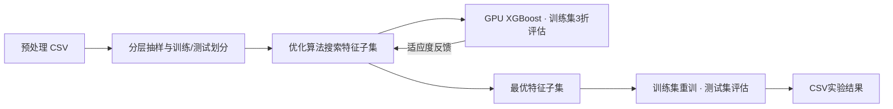

<h1 align="center">EABWO-FS</h1>

<p align="center"><strong>面向预处理 CSV 的 GPU 特征选择与对比实验</strong></p>

<p align="center">
  
  
  
  
  
  
</p>


<p align="center">
  <a href="#快速开始">快速开始</a> ·
  <a href="#实验设置">实验设置</a> ·
  <a href="#三卡消融实验">三卡消融</a> ·
  <a href="#结果文件">结果文件</a> ·
  <a href="#代码结构">代码结构</a>
</p>


---

## 项目介绍

EABWO-FS 将增强型自适应白鲸优化算法（Enhanced Adaptive Beluga Whale Optimization，EABWO）与 GPU XGBoost 结合，在分类任务中搜索特征子集，同时考虑分类效果与特征数量。

项目直接读取使用者提供的预处理 CSV，包含两条实验流程：

| 流程     | 入口                       | 实验内容                                      |
| -------- | -------------------------- | --------------------------------------------- |
| 算法对比 | `comparison_experiment.py` | GA、PSO、ABC、BA、BWO、EABWO，共6种算法       |
| 策略消融 | `run_ablation_cuml.py`     | S1、S2、S3的8种开关组合，统一使用 GPU XGBoost |

**30个体 · 50次迭代 · 分层3折 · 默认5轮 · 种子42—46**



## 快速开始

### 1. 配置环境

建议使用 Linux 或 WSL2 的 NVIDIA GPU 环境，可选择 Python 3.10/3.11 配置环境；此建议不代表完整的已测试版本矩阵。

进入解压后的项目目录，安装基础依赖与对比算法库：

```bash
cd EABWO_FS-main
python -m pip install -r requirements.txt
python -m pip install mealpy
```

另需安装与本机 CUDA 匹配的 CuPy。例如，CUDA 12.x 环境可使用：

```bash
python -m pip install cupy-cuda12x
```

`requirements.txt` 尚未列出 CuPy 和 Mealpy，不能仅依靠该文件完成 GPU 对比环境安装。CuPy 发行包应按实际 CUDA 版本选择；上述命令是 CUDA 12.x 的示例。

| 依赖                        | 用途                               |
| --------------------------- | ---------------------------------- |
| NumPy、pandas、scikit-learn | 数据读取、抽样、划分与指标计算     |
| SciPy                       | Lévy飞行相关常量计算               |
| CuPy                        | GPU数组与EABWO搜索                 |
| XGBoost                     | GPU分类器及适应度评估              |
| Mealpy                      | GA、PSO、ABC、BA的实现             |
| matplotlib                  | 可选的收敛曲线绘制                 |
| RAPIDS cuML                 | 可选，仅使用随机森林评估分支时需要 |

默认两条实验流程均使用 XGBoost，不要求安装 cuML。XGBoost 2.x及以上使用 `tree_method="hist", device="cuda"`；代码为1.x保留 `tree_method="gpu_hist"` 分支。实际运行需要可用的 GPU XGBoost 环境。

### 2. 放入自己的数据

数据集由使用者自行准备，当前压缩包未包含实验数据集。CSV采用有表头的数值特征列与标签列，每行对应一个样本。

```text
EABWO_FS-main/
├── comparison_experiment.py
├── run_ablation_cuml.py
└── datasets/
    └── my_data.csv
```

下例仅说明列结构，不是可直接用于默认抽样设置的实验数据：

```csv
feature_1,feature_2,feature_3,Label
0.12,1.45,0.00,normal
0.85,0.32,1.00,attack
0.24,0.91,0.00,normal
```

对比实验默认标签列为 `Label`；消融实验默认标签列为最后一列，也可以通过 `--label` 指定。标签会由 `LabelEncoder` 编码，支持二分类与多分类。

本文使用数据集（此为未经数据预处理的数据，实验使用SplitCap.exe处理合并过的数据）

Edge-IIoT获取路径：https://www.kaggle.com/datasets/mohamedamineferrag/edgeiiotset-cyber-security-dataset-of-iot-iiot

USTC-TFC2016获取路径：https://github.com/davidyslu/USTC-TFC2016.git

### 3. 启动实验

```bash
# 六种算法对比
python comparison_experiment.py --dataset datasets/my_data.csv

# 八种策略组合消融
python run_ablation_cuml.py --dataset datasets/my_data.csv
```

CSV与脚本放在同一目录时，直接传入文件名：`--dataset my_data.csv`。**相对路径按脚本所在目录解析**，也支持绝对路径；含空格的路径加引号。参数需要包含CSV文件名。

自定义标签列和输出位置：

```bash
python comparison_experiment.py --dataset datasets/my_data.csv --label target --save_dir results/custom_comparison
python run_ablation_cuml.py --dataset datasets/my_data.csv --label target --save_dir results/custom_ablation
```

## 实验设置

### 默认参数

| 参数           | 算法对比                         | 策略消融                            |
| -------------- | -------------------------------- | ----------------------------------- |
| 种群数         | 30                               | 30                                  |
| 迭代次数       | 50                               | 50                                  |
| 交叉验证       | 分层3折                          | 分层3折                             |
| 运行次数       | 5                                | 默认5，可通过 `--runs` 调整         |
| 各轮种子       | 42、43、44、45、46               | 默认42、43、44、45、46              |
| 特征惩罚系数 α | 0.01                             | 0.01                                |
| 测试集比例     | 0.3                              | 0.3                                 |
| 抽样           | 循环外使用seed=42分层抽样20000条 | 每轮按该轮seed分层抽样，最多50000条 |
| 标准化         | 在训练集拟合，再变换测试集       | 入口使用 `normalize=False`          |
| 分类器         | GPU XGBoost                      | GPU XGBoost                         |

两条入口的抽样和标准化设置有所不同。对比入口的 `SAMPLE_SIZE`、`USE_SAMPLING` 等配置位于 `comparison_experiment.py` 文件顶部；数据规模不适合默认20000条抽样时，可调整这两个常量。消融入口可用 `--max_samples 0` 关闭下采样。

每轮在训练集上预生成交叉验证索引，并在候选特征子集之间复用。搜索完成后，用所选特征在完整训练集上重训分类器，再计算测试集指标。

### 适应度与特征编码

最小化目标：

```text
fitness = (1 - mean_cv_accuracy) + α × (n_selected / n_total)
```

`mean_cv_accuracy` 为3折验证准确率的均值。连续搜索范围为 `[-6, 6]`，通过 sigmoid 的0.5阈值转换为特征掩码；全部特征未选中时，沿用随机补选一个特征的逻辑。

### EABWO策略消融

| 策略 | 作用                                   |
| ---- | -------------------------------------- |
| S1   | 动态非线性平衡控制，调节探索与开发阶段 |
| S2   | 增强鲸鱼坠落行为，引导位置更新         |
| S3   | 连续10轮全局最优无改善后触发变异       |

| 配置名称           |  S1  |  S2  |  S3  |
| ------------------ | :--: | :--: | :--: |
| Base_BWO + XGBoost |  —   |  —   |  —   |
| S1 + XGBoost       |  ✓   |  —   |  —   |
| S2 + XGBoost       |  —   |  ✓   |  —   |
| S3 + XGBoost       |  —   |  —   |  ✓   |
| S1+S2 + XGBoost    |  ✓   |  ✓   |  —   |
| S1+S3 + XGBoost    |  ✓   |  —   |  ✓   |
| S2+S3 + XGBoost    |  —   |  ✓   |  ✓   |
| EABWO + XGBoost    |  ✓   |  ✓   |  ✓   |

`Base_BWO` 表示当前EABWO关闭三个策略的配置，与 `BWO.py` 中独立的BWO实现不完全等价。

## 命令行参数

### 算法对比：`comparison_experiment.py`

| 参数         | 默认值                          | 含义              |
| ------------ | ------------------------------- | ----------------- |
| `--dataset`  | 必填                            | 预处理CSV文件路径 |
| `--label`    | `Label`                         | 标签列名          |
| `--save_dir` | `results/<数据集名>/comparison` | 结果目录          |

种群数、迭代次数、折数、5轮运行和基础种子由文件顶部常量控制，当前对比入口未提供对应的命令行参数。

### 策略消融：`run_ablation_cuml.py`

| 参数            | 默认值                        | 含义                            |
| --------------- | ----------------------------- | ------------------------------- |
| `--dataset`     | 必填                          | 预处理CSV文件路径               |
| `--label`       | 最后一列                      | 标签列名                        |
| `--runs`        | `5`                           | 每种配置的总运行轮数            |
| `--save_dir`    | `results/<数据集名>/ablation` | 结果目录                        |
| `--max_samples` | `50000`                       | 最大抽样数；`0`表示使用全部样本 |
| `--shard`       | `0`                           | 当前进程分片编号，从0开始       |
| `--nshards`     | `1`                           | 分片总数                        |
| `--merge`       | 关闭                          | 只合并分片结果                  |

数据集名取CSV文件名去掉扩展名；自定义的相对结果目录同样按脚本所在目录解析。

## 三卡消融实验

**默认直接运行时，每个进程使用一张可见GPU。**EABWO搜索采用CuPy，分类器采用GPU XGBoost；Mealpy和BWO的搜索逻辑主要在CPU上执行。`n_jobs=-1` 控制CPU线程，不表示使用多张GPU。

消融可启动三个独立进程，每个进程绑定一张卡并承担不同轮次。以下为 Linux/WSL 的 Bash 示例，在项目目录执行：

```bash
DATA="datasets/my_data.csv"
OUT="results/my_data/ablation"

CUDA_VISIBLE_DEVICES=0 python run_ablation_cuml.py --dataset "$DATA" --save_dir "$OUT" --runs 5 --nshards 3 --shard 0 > shard0.log 2>&1 &
CUDA_VISIBLE_DEVICES=1 python run_ablation_cuml.py --dataset "$DATA" --save_dir "$OUT" --runs 5 --nshards 3 --shard 1 > shard1.log 2>&1 &
CUDA_VISIBLE_DEVICES=2 python run_ablation_cuml.py --dataset "$DATA" --save_dir "$OUT" --runs 5 --nshards 3 --shard 2 > shard2.log 2>&1 &
wait

python run_ablation_cuml.py --dataset "$DATA" --save_dir "$OUT" --runs 5 --merge
```

三个进程合计完成每种配置的5轮：分片0负责第1、4轮，分片1负责第2、5轮，分片2负责第3轮。各进程独立训练分类器，不是同一个XGBoost模型跨三卡训练。对比入口目前没有分片参数。

现有 `run3gpu.sh` 采用相同的启动方式，但 `D`、`S` 仍是旧机器的固定路径。可使用上面的命令，也可调整脚本中的两个变量后执行 `bash run3gpu.sh`。

## 结果文件

```text
results/
└── my_data/
    ├── comparison/
    │   ├── results_main.csv
    │   ├── results_convergence.csv
    │   └── results_final_population.csv
    └── ablation/
        ├── ablation_my_data_summary.csv
        └── ablation_my_data_detail.csv
```

### 对比结果

| 文件                           | 内容                                                      |
| ------------------------------ | --------------------------------------------------------- |
| `results_main.csv`             | 每个算法、每轮的指标，全部成功时共30条记录                |
| `results_convergence.csv`      | `algorithm, run, iteration, best_fitness`，每轮的收敛过程 |
| `results_final_population.csv` | `algorithm, run, individual, fitness`，最终种群适应度     |

主结果包含 `algorithm`、`run`、`seed`、`accuracy`、`f1_score`、`feature_selection_rate`、`n_selected_features`、`n_total_features`、`best_fitness`、`selected_features`、`computation_time`。

`selected_features` 是从0开始、按移除标签列后的特征顺序编号的索引，以分号分隔。`computation_time` 为搜索阶段耗时，不包含数据加载和最终测试集评估。各算法的均值与标准差显示在控制台，当前没有另存对比汇总CSV。

### 消融结果与续跑

详细结果包含 `Configuration`、`Run`、`Seed`、`Fitness`、`Accuracy`、`Precision`、`Recall`、`F1-Score`、`Num_Features`。8种配置各5轮全部成功时共40条记录。

汇总结果包含策略开关、最好/最差适应度，以及适应度、准确率、F1、特征数的均值与标准差；合并后的汇总另含 `Runs`。多进程阶段的文件名带 `_shard0` 等分片标记，合并后生成上述最终文件。

消融入口会读取同一结果目录下已有的详细记录，按 `(Configuration, Run)` 跳过已完成的整轮。再次执行相同命令即可继续剩余任务；变更实验参数时使用新的 `--save_dir` 区分结果。该机制不恢复轮内的优化器种群。对比入口在实验结束时统一写出CSV，没有自动续跑功能。

两条入口的二分类F1使用 `binary` 平均方式，多分类使用 `weighted` 平均方式。

## 代码结构

| 文件或目录                       | 职责                                             |
| -------------------------------- | ------------------------------------------------ |
| `comparison_experiment.py`       | 六算法GPU评估、五轮对比与结果导出                |
| `run_ablation_cuml.py`           | 八种消融配置、分片、整轮续跑与合并               |
| `EABWO_Featureselection_cuml.py` | 数据加载、特征编码、3折适应度和最终评估          |
| `EABWO_cuml.py`                  | CuPy版EABWO优化器与S1/S2/S3策略                  |
| `BWO.py`                         | 用于算法对比的独立BWO实现                        |
| `run3gpu.sh`                     | 三进程消融启动示例                               |
| `requirements.txt`               | 基础Python依赖                                   |
| `ablation/`                      | 压缩包附带的历史结果与检查点文件                 |
| `算法设计文档.md`                | 算法背景与公式说明                               |
| `对比实验说明.md`                | 旧版说明；运行入口及参数以当前源码和本README为准 |

建议按“实验入口 → 特征选择封装 → EABWO核心”阅读。当前版本按脚本组织；`__init__.py` 的旧包导出引用了包内已不存在的模块，应使用上述脚本入口或直接导入具体模块。

`FeatureSelectionEABWO` 提供 `load_data()`、`fit()`、`evaluate()`、`get_selected_data()` 和 `plot_convergence()`。其中 `get_selected_data()` 返回所选特征的训练/测试数据及标签；绘图需要安装matplotlib。直接调用 `load_data()` 时，相对文件路径遵循Python进程的当前工作目录。

## 常见问题

**为什么命令使用 `comparison_experiment.py`？** 这是当前压缩包实际提供的对比入口，内容已是GPU对比流程；包内没有 `run_comparison.py`。

**启动GPU实验会自动使用三张卡吗？** 默认不会。三卡消融需要显式启动三个绑定不同GPU的进程，并设置对应分片。

**为什么重新启动消融时提示某轮已完成？** 同一目录中的详细结果会用于整轮续跑。需要重新运行或调整参数时，指定新的结果目录。

## 贡献与许可

提交实验相关变更时，建议附上数据集说明、运行命令、参数和结果字段变化，便于复现。

当前压缩包未提供 `LICENSE` 文件，许可证信息待项目维护者补充。
